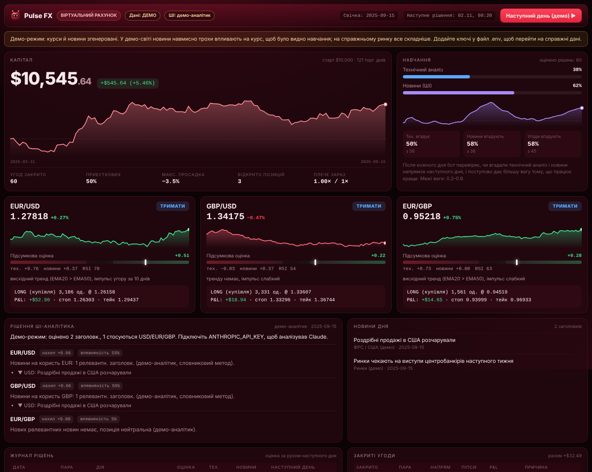

# Pulse FX — ШІ-аналітик валютних пар на віртуальному рахунку



Бот раз на день аналізує **EUR/USD, GBP/USD, EUR/GBP**:
- бере курси і новини центробанків;
- просить Claude оцінити, куди найімовірніше піде кожна пара;
- поєднує цю оцінку з технічним аналізом;
- відкриває та закриває **віртуальні** угоди;
- вчиться на результатах.

**Справжніх грошей і брокера тут немає.** Мета — кілька тижнів подивитися, чи бот справді приймає кращі рішення, ніж випадковість.

## Запуск

Потрібен Node.js 20+.

```bash
cd forex-bot
npm install
node server.mjs          # дашборд: http://localhost:5174
```

Без ключів бот працює в **демо-режимі**: курси й новини згенеровані. При першому запуску він прокручує 120 торгових днів, щоб одразу було видно, як він торгує й навчається. Кнопка «Наступний день (демо)» додає ще один день.

### Справжні дані

1. Скопіюйте `.env.example` у `.env`.
2. Впишіть ключі:
   - `TWELVEDATA_API_KEY` — безкоштовний ключ на twelvedata.com (котирування);
   - `ANTHROPIC_API_KEY` — ключ API Anthropic на console.anthropic.com. Він потрібен, щоб новини аналізував Claude. Один запит на день, оплата за використання.
3. Перезапустіть `node server.mjs`.

Ключі зберігаються лише у файлі `.env` на вашому комп'ютері, у git він не потрапляє. Можна підключити тільки Twelve Data: тоді курси будуть справжні, а новини аналізуватиме простий демо-аналітик.

### Коли бот приймає рішення

Щодня о `DECISION_TIME_UTC` (за замовчуванням 00:20 UTC, одразу після закриття денної свічки), поки працює `node server.mjs`. Якщо сервер не тримати ввімкненим, можна запускати один цикл за розкладом системи:

```bash
node cli.mjs run      # один цикл (для cron / Планувальника завдань Windows)
node cli.mjs status   # стан рахунку
node cli.mjs reset    # почати рахунок заново
```

Повторний запуск в той самий день нічого не ламає. Якщо нової свічки немає (вихідні), бот так і пише й нічого не змінює.

## Як бот вирішує

| Крок | Що відбувається |
|---|---|
| **Дані** | Денні свічки за ~200 днів (Twelve Data). Незакрита сьогоднішня свічка відкидається |
| **Новини** | RSS ЄЦБ, ФРС і Банку Англії за останні 4 дні, плюс ваші стрічки з `NEWS_FEEDS` |
| **Технічний аналіз** | Тренд (EMA20 / EMA50), 10-денний імпульс, RSI. Результат — оцінка від −1 до +1 |
| **ШІ-аналітик** | Claude (`claude-opus-5-5`) отримує новини, технічну картину та історію своїх минулих рішень. Повертає структурований JSON: нахил −1…+1, впевненість, «важлива подія попереду», пояснення українською |
| **Рішення** | `оцінка = вага_тех × технічний + вага_новин × (нахил × впевненість)`. Купити, якщо оцінка > 0.15; продати, якщо < −0.15; інакше чекати |
| **Guard** | Ризик 1% капіталу на угоду, стоп 1.5 × ATR, тейк 3 × ATR, трейлінг-стоп. Ліміт плеча 1× на всі пари разом. Перед важливою подією розмір ×0.5. При просадці 10% від піку бот закриває все й бере паузу на 5 днів |
| **Навчання** | Кожне рішення перевіряється за рухом наступного дня. Вага поступово переходить до того сигналу, який реально вгадує (межі 0.2–0.8). Claude бачить свої останні влучання й помилки |

Якщо Claude недоступний або відмовився відповідати, бот того дня торгує лише за технічним аналізом. Причина видна в дашборді.

## Що варто знати

- **Демо — це не доказ.** У демо-світі новини навмисно трохи впливають на курс наступного дня, щоб було видно навчання. На справжньому ринку такого зв'язку може не бути зовсім.
- **Новинні RSS-стрічки ще не перевірені наживо.** Їх писали в середовищі без доступу до інтернету. Якщо якась стрічка не відповідає, бот працює без неї, а в дашборді з'являється попередження. Тоді її можна замінити своєю через `NEWS_FEEDS`.
- **Віртуальний рахунок спрощений.** Спред враховано, але свопи (плата за перенесення позиції через ніч) і прослизання при гепах — ні.
- **Справжня торгівля** — окремий наступний крок. Її варто розглядати лише після кількох тижнів стабільного результату тут, і спершу на демо-рахунку брокера.

## Файли

- `server.mjs` — дашборд, API і щоденний розклад.
- `cli.mjs` — запуск із командного рядка.
- `lib/` — дані, новини, аналітик, рахунок і Guard, навчання, цикл.
- `public/` — дашборд.
- `data/state.json` — стан рахунку. Створюється автоматично, у git не потрапляє.
- `test.mjs` — тести (`npm test`), без мережі: Twelve Data, RSS і Claude підмінені заглушками.
