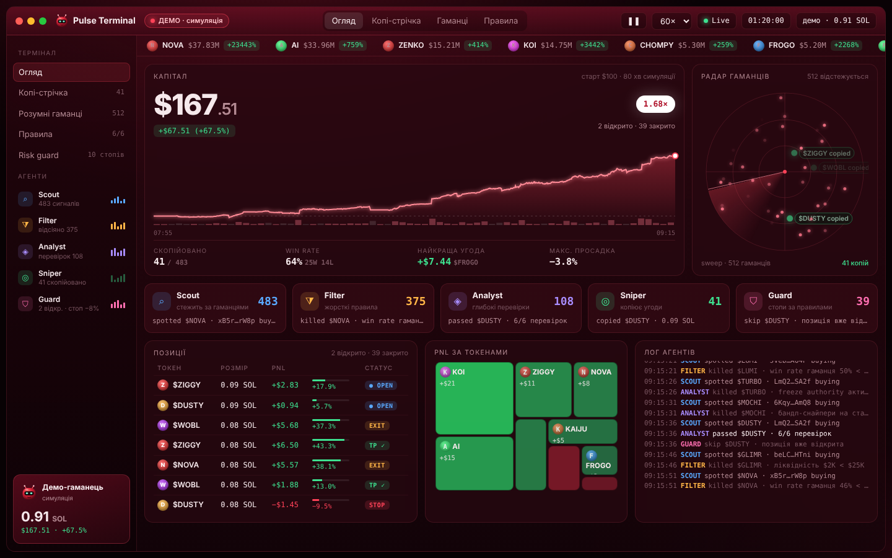

# Pulse Terminal — демо-дашборд копітрейдинг-бота



**Це демонстрація інтерфейсу.** Реальної торгівлі тут немає: програма не підключається до блокчейну, біржі чи гаманця й не просить ключів. Усі токени, ціни, гаманці та угоди генерує локальний симулятор. На екрані завжди видно позначку «ДЕМО · симуляція».

## Запуск

Потрібен Node.js 18 або новіший. Залежностей немає.

```bash
cd trading-bot
node server.mjs        # або: npm start
```

Потім відкрийте http://localhost:5173 (інший порт можна задати так: `PORT=8080 node server.mjs`).

Перевірка симулятора: `node test.mjs` (або `npm test`).

## Що на екрані

- **Огляд:**
  - капітал і множник (×);
  - графік капіталу з підказкою при наведенні;
  - win rate, найкраща угода, макс. просадка;
  - радар гаманців;
  - ланцюжок агентів;
  - позиції, PnL за токенами (treemap), лог агентів.
- **Копі-стрічка:** усі закриті угоди з причиною виходу (TP / STOP / EXIT).
- **Гаманці:** 48 вигаданих гаманців (з «512»), їхній win rate і наш PnL на їхніх копіях.
- **Правила:**
  - фільтри (ліквідність, частка топ-холдера, win rate гаманця);
  - розмір позиції, тейк-профіт, стоп-лосс, трейлінг, ліміт позицій;
  - настрій ринку, стартовий капітал, seed.

  Налаштування зберігаються в браузері.
- **Керування:** пауза, швидкість 1× / 5× / 20× / 60× (кроків симуляції за секунду; 1 крок = 5 с ринкового часу).

## Як працює симулятор (`public/sim.mjs`)

1. **Scout.** Ціни токенів рухаються випадково (волатильність, пампи, зливи, рагпули). Вигадані гаманці купують токени, Scout бачить ці покупки. «Розумніші» гаманці частіше обирають токени з позитивним імпульсом.
2. **Filter** відсіює сигнали за правилами.
3. **Analyst** робить 6 «глибоких перевірок»: mint/freeze authority, LP lock, honeypot, dev, бандли.
4. **Sniper** купує із запізненням, прослизанням і комісією.
5. **Guard** закриває позиції за стоп-лоссом, тейк-профітом, трейлінгом або при рагпулі. Якщо гаманець, який ми копіюємо, продає, копія теж виходить.

Модель свідомо реалістична. На нейтральному ринку медіанний результат за годину близько 1.0×, і приблизно половина прогонів збиткові (це перевіряє `test.mjs`). Однаковий seed завжди дає однаковий результат.

## Важливо

Не видавайте записи цього екрана за реальну прибутковість і не використовуйте їх, щоб заманювати людей у «ботів». Саме так працюють шахрайські ролики, з яких цей дизайн натхненний. Назва, маскот і код оригінальні й не пов'язані з жодним брендом.
